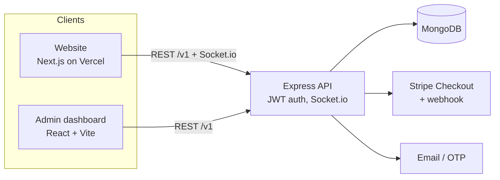

# MyNextHome: Real-Estate Marketplace for Bangladesh

A full-stack platform for renting, buying and listing property across all 64 districts of Bangladesh. Tenants search and save homes, chat with owners in real time and book viewings; landlords list and promote properties and track interest; admins moderate users and listings.

**Live demo:** _add your Vercel link here_ · **Repos:** [Website](https://github.com/abusayedwd/property-rental-website) · [API](https://github.com/abusayedwd/property-rental-serverr) · [Admin dashboard](https://github.com/abusayedwd/property-rental-dashboard)

> **Demo accounts** _(fill in before sharing)_
> | Role | Email | Password |
> |---|---|---|
> | Tenant | `tenant@demo.com` | `…` |
> | Landlord | `landlord@demo.com` | `…` |
> | Admin (dashboard) | `admin@demo.com` | `…` |

<!-- Add 3–4 screenshots or a short GIF here: home, search, property page, chat -->

---

## Features

**Renters & buyers**
- Search by district and area (all 64 districts, 500+ areas), rent or sale, property type, bedrooms and price range in Taka, with sorting and pagination
- Property pages with photo gallery, map, key facts and similar listings
- Save favourites; get notified about activity on your requests
- **Real-time chat** with owners: typing indicator, read receipts, online status, unread counts
- **Viewing appointments:** request a day and time slot; the owner confirms or declines with a note
- **Notification centre** (bell) updated live over WebSockets
- Report suspicious or wrong listings

**Landlords**
- Create and edit listings with up to 5 photos
- Per-listing analytics: views, saves and pending viewing requests
- Confirm/decline viewing requests; mark properties rented or sold
- Promote a listing to "Featured" with **Stripe Checkout**

**Admins** (separate React dashboard)
- Overview with earnings chart, user and landlord management (details, block/unblock)
- Review reported listings; hide or restore any listing (owner is notified)
- Manage banners, contact info and site content

**Quality**
- Responsive on phone, tablet and desktop; SEO metadata per page, dynamic Open Graph images for listings, sitemap and robots.txt
- Authorisation checks on every mutating endpoint (ownership, roles, field allow-lists)

## Tech stack

| Layer | Technology |
|---|---|
| Website | Next.js 15 (App Router), React 19, Redux Toolkit / RTK Query, Tailwind CSS, Ant Design, Socket.io client |
| Admin dashboard | React 18 + Vite, Redux Toolkit, Ant Design, Recharts |
| API | Node.js, Express, MongoDB + Mongoose, Passport JWT, Socket.io, Stripe, Nodemailer, Multer |
| Deployment | Vercel (website), Node server on a VPS |

## Architecture



- **Real-time:** the socket authenticates with the same JWT as the API; every user joins a private room, so messages, typing, read receipts and notifications only reach the people involved.
- **Search:** server-side filtering and pagination (district, area, price range, bedrooms, text search) with featured listings ranked first.
- **Hosting note:** the Vercel site can proxy the API through `/backend` so the browser never calls a plain-http backend (see `BACKEND_URL` below).

## Engineering highlights

- **Security fixes found and closed during development:** IDOR on user and property updates/deletes, privilege escalation through profile updates (`role`, `isBlocked`), free "promotion" via the edit form, a public endpoint that exposed total earnings, broadcast of private chat messages to every client, and unauthenticated socket rooms.
- **Real-time messaging rebuilt end to end:** optimistic sending with retry, de-duplication by client ID, unread counts, presence and read receipts.
- **Domain fit for Bangladesh:** Taka formatting with lakh/crore grouping, district → upazila location data, Bangladesh-specific copy.

## Getting started

```bash
git clone https://github.com/abusayedwd/property-rental-website.git
cd property-rental-website
npm install
cp .env.example .env.local   # then edit the values
npm run dev                  # http://localhost:3004
```

The API must be running too (see the [API repo](https://github.com/abusayedwd/property-rental-serverr)).

### Environment variables

| Name | Example | Purpose |
|---|---|---|
| `NEXT_PUBLIC_BASE_URL` | `http://localhost:3070` or `/backend` | API address used in the browser (`/backend` when proxied) |
| `BACKEND_URL` | `http://168.231.67.56:3090` | Optional. Enables the `/backend` proxy (use on Vercel if the API has no https) |
| `NEXT_PUBLIC_SITE_URL` | `https://mynexthome.vercel.app` | Public site address for share previews and the sitemap |

## Project structure

```
src/
  app/                 # routes (App Router) + per-page metadata, sitemap, robots, icons
  components/
    property/          # PropertyCard, PropertyListing (search), viewing & report dialogs
    messages/          # real-time chat
    pages/             # Navbar, Footer
  redux/               # RTK Query API slices
  utils/               # socket client, site config, price formatting
```

## Roadmap

- [ ] Photo storage on Cloudinary/S3 (uploads are on the server disk today)
- [ ] Map search with geo queries
- [ ] Automated tests (Jest + Supertest, Playwright) and GitHub Actions CI
- [ ] Saved searches with email alerts
- [ ] Bangla / English language switch
